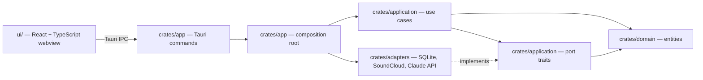

<div align="center">


<h1>SoundCloud Crate Sorter</h1>

<p>Turns a DJ's SoundCloud likes into confidence-scored, organized crates.</p>

<p>
  
  <a href="LICENSE"></a>
  
  
</p>

</div>

## Why

A SoundCloud likes library grows into one flat, unsorted list of thousands of tracks. Before a set,
a DJ has to dig through it by hand to find what fits a genre and a moment of the night. This tool
scans a user's public likes (no login), deduplicates them, and sorts each track into one crate
(genre × energy role) with a confidence score, so only the uncertain tracks need a human decision.

## Features

Status per increment, as tracked in [`specs/001-soundcloud-crate-sorter/tasks.md`](specs/001-soundcloud-crate-sorter/tasks.md):

| Increment | User stories | State |
|---|---|---|
| **MVP** | US1 — scan → dedup → classify → crates (metadata only) | implemented |
| Increment 2 | US2 — manual triage | implemented |
| Increment 3 | US4 + US5 — audio analysis + local/Rekordbox export | planned |
| v2 | US3 — SoundCloud playlist write (gated API) | deferred |

### Working today

- **Scan** a public SoundCloud profile's likes through the unofficial `api-v2.soundcloud.com`
  endpoints, with `client_id` extraction, cursor pagination and rate-limit retry.
- **Deduplicate** liked tracks by SoundCloud track id; every collapsed duplicate is audited.
- **Classify** each track into a genre × energy-role crate (Warmup, Groove, Peak, Closing): genre
  from the source tag, or from the Claude API when the tag is missing or ambiguous.
- **Route** by confidence: at or above the threshold (default `0.6`) a track is auto-sorted, below
  it goes to the triage queue.
- **Triage** uncertain tracks with swipe cards or a dense assignment table: accept the suggestion,
  pick an alternative, open a searchable crate picker, create a crate on the fly, or defer.
- **Adjust the threshold** with a live auto/manual split preview; manual decisions are never
  overwritten when tracks are re-routed.
- **Audit trail** per track ("why is this track here?"), persisted in a local SQLite database.

### Planned

- **Audio analysis** (opt-in download): deterministic BPM, Camelot key and energy.
- **Local / Rekordbox export**: per-crate folders, ID3-tagged files and M3U8 playlists.
- **SoundCloud playlist write** (v2, gated API).

## Install

Prerequisites:

- **Rust** stable 1.80+ with Cargo.
- **Node.js** and **pnpm** for the `ui/` React app.
- **Tauri v2 system dependencies** for your OS: see the
  [Tauri prerequisites](https://v2.tauri.app/start/prerequisites/).
- **Tauri CLI**: `cargo install tauri-cli --version "^2"`.
- The metadata-only workflow (US1/US2) needs no other system library.
- **Audio analysis / export (US4/US5, planned)** needs these native libs (macOS Apple Silicon):

  ```sh
  brew install libkeyfinder   # pulls fftw
  brew install aubio
  brew install yt-dlp
  ./scripts/check-system-libs.sh   # verify
  ```

  > libKeyFinder is **GPL-3.0**, which makes the linked binary GPL-3.0. This is a personal,
  > non-distributed build (constitution Principle II).

## Quick start

```sh
git clone https://github.com/Azurioh/soundcloud-crate-sorter.git
cd soundcloud-crate-sorter
cp .env.example .env        # then set ANTHROPIC_API_KEY=...
cd ui && pnpm install && cd ..
cargo tauri dev             # starts the Vite dev server and the desktop app
```

Configuration (environment, loaded from `.env`):

| Variable | Purpose |
|---|---|
| `ANTHROPIC_API_KEY` | Key for the AI genre/vibe classifier (Claude API). Never logged, never committed. |
| `SCS_DB_PATH` | Optional SQLite database path. Defaults to `crate-sorter.sqlite` in the app data directory. |

## Usage

1. Paste a public SoundCloud profile URL and run the **scan**, then **classify** the library.
2. Review the **triage** queue. Keyboard shortcuts:

   | Key | Action |
   |---|---|
   | `a` | Accept the top suggestion |
   | `1` `2` `3` | Pick the 1st / 2nd / 3rd alternative |
   | `p` | Open the searchable crate picker |
   | `d` | Defer the track to a later session |

   Swiping a card right accepts, left defers. Deferred tracks can be returned to the queue.
3. Tune the **confidence threshold** and check the auto/manual split before committing it.
4. Browse the resulting **crates** and open a track's audit trail to see why it landed there.

## Architecture

A Cargo workspace with one crate per Clean Architecture layer, so the dependency rule is enforced
by the compiler.



- `domain` depends on nothing app-specific: no I/O, no vendor crates.
- `application` depends on `domain` only and defines the ports (traits) it needs.
- `adapters` implements those ports and maps vendor/DB types at the edge.
- `app` is the only crate that wires concrete adapters into use cases (`composition_root.rs`).
- Each crate's `Cargo.toml` lists only the dependencies its layer may see, so a boundary violation
  fails to compile.

The full spec, plan, data model and port contracts live in
[`specs/001-soundcloud-crate-sorter/`](specs/001-soundcloud-crate-sorter/).

## Project structure

```text
.
├── crates/
│   ├── domain/        # entities: track, crate, classification, confidence, Camelot key, audit
│   ├── application/   # use cases, port traits, in-memory testkit fakes
│   ├── adapters/      # SQLite repositories, SoundCloud likes source, Claude classifier
│   │   └── tests/     # port contract tests + triage pipeline integration test
│   └── app/           # Tauri shell: commands, composition root, config, logging
├── ui/
│   └── src/
│       ├── features/  # run, triage, crates
│       └── shared/    # API client, UI primitives, theme
├── scripts/           # check-system-libs.sh
└── specs/             # spec-kit artifacts: spec, plan, data model, contracts, tasks
```

## Development

```sh
cargo tauri dev                                        # run the desktop app with hot reload
cargo tauri build                                      # production build (runs `pnpm build` in ui/)
cargo test                                             # use-case unit tests + port contract tests (offline)
cargo test --features real-adapters                    # contract tests against real adapters (network / API key)
cargo clippy --workspace --all-targets -- -D warnings  # lint, warnings are errors
cargo fmt --all                                        # format
cd ui && pnpm typecheck                                # frontend type-check
cd ui && pnpm build                                    # frontend type-check + Vite build
```

Every use case has isolation tests against in-memory port fakes; every port has a contract test that
runs against both the in-memory fake and the real adapter (constitution Principle VI).

## License

[MIT](LICENSE).
